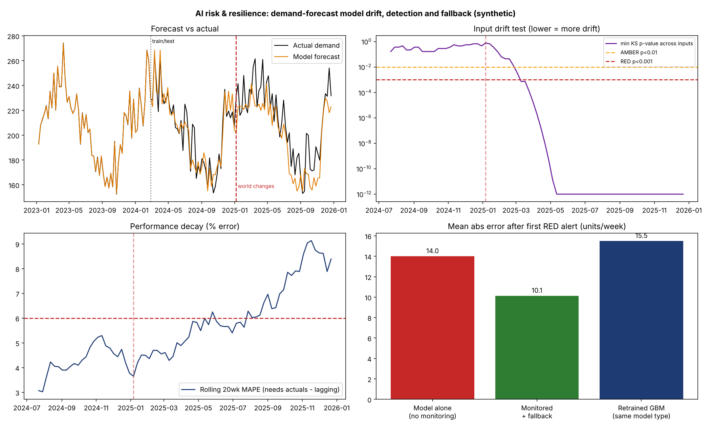

# AI risk and resilience assessment

> Drift monitoring, fallback design and an AI risk register for a demand-forecasting model (synthetic data).




**Problem.** A machine-learning model drives stock allocation. How can it fail, how would we know, and what keeps the
business running when it does?

**Part A: drift demonstration.** Synthetic weekly demand with a planted change at 6 Jan 2025 (price inflation, promotions
working less, new product mix). The model trained on the first 60 weeks degrades after that date. Monitoring compares the
latest 20 weeks of inputs to the training data (two-sample KS test per feature) and tracks rolling forecast error.
A simple challenger model re-fitted weekly on the last 26 weeks is the pre-agreed fallback.

**Results.**
- No false alarms in the 24 monitored weeks before the change.
- First amber alert 3 March 2025, red 21 April 2025. Detection lags the change by about 8 weeks because a 20-week window needs time to fill. Shorter windows detect sooner but alarm more.
- Input-drift monitoring flagged the problem before the error metric did, because error needs actual sales to arrive.
- Mean error after the first red alert: model alone 14.0 units/week, monitored with fallback 10.1, retrained gradient boosting 15.5. Retraining the same model type on a short window did not help here (tree models cannot extrapolate to new price levels), so the fallback needs to be a different, adaptable model. This was a finding, not what I expected.
- Classic PSI thresholds (0.1 / 0.25) gave false alarms on 20-week windows (two identical distributions score about 0.25 by chance), so alerts use KS tests instead.

**Part B: AI risk register** (`ai_risk_register.csv`): 8 risks (drift, silent input failure, third-party model outage, over-reliance,
bias across stores, change control, privacy, explainability), each with cause, impact, likelihood x impact score, controls, KRIs and suggested owner.
Highest: drift (16) and silent input failure (15).

**What I would tell leadership.** Approve three controls before relying on the model: input and drift monitoring with
agreed thresholds, a tested fallback with its accuracy known in advance, and a named owner who decides when to switch.

**Limitations.** Synthetic data. Ratings in the register are my proposals for discussion with owners, not agreed scores.

Files: `ai_risk_assessment.py`, `ai_drift_monitoring.png`, `monitoring_log.csv`, `ai_risk_register.csv`.

## Run it
```
pip install -r requirements.txt
python3 ai_risk_assessment.py
```
Fixed random seeds, so results reproduce exactly. All data is synthetic or assumption-based; no real company data is used.

Part of a series of data-driven risk and operational resilience projects by Suhas Suresha.
